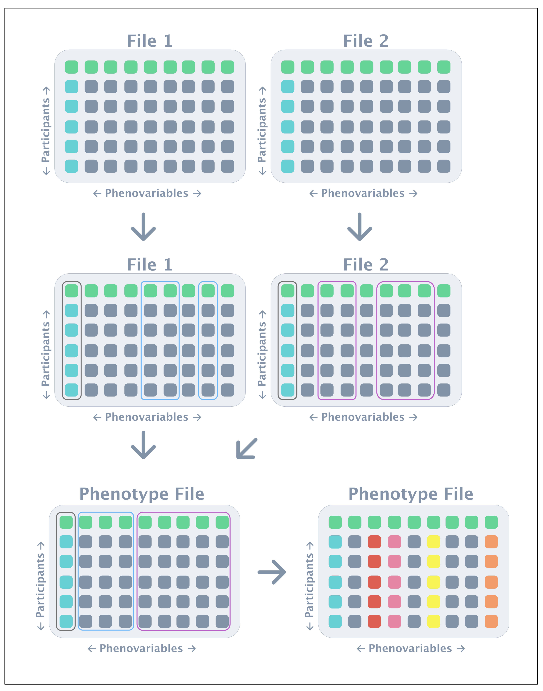
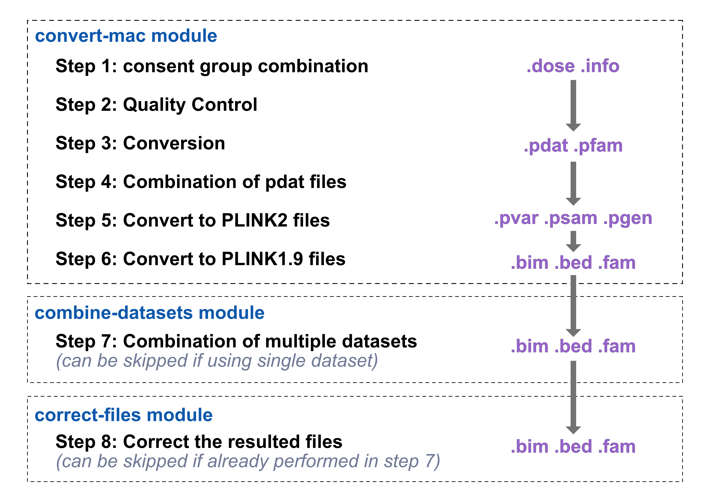

<p align="center">
    
</p>

# Canary

## Introduction

Canary is a bioinformatics tool published in BMC Bioinformatics (<https://link.springer.com/article/10.1186/s12859-022-04822-8>) that converts MaCH and minimac dosage files (`.dose` and `.info`) into PLINK files. The container also includes software commonly used for GWAS.

This repository is the guide for that conversion, using MaCH files such as those provided by dbGaP for the Women's Health Initiative (WHI). Phenotype files are prepared separately. A Python tutorial is included. The conversion scripts do not build the phenotype file.

### Software Installed in Canary

The Canary container comes with software essential for performing GWAS analyses installed, including:

- PLINK 1.9
- PLINK 2
- BCFtools
- SRA Toolkit
- GCTA 1.93.2beta (the binary is `/gcta/gcta_1.93.2beta/gcta64`)
- Python 3, with pandas and NumPy
- R, with GWASTools (Bioconductor), tidyverse, and qqman

Users are recommended to familiarise themselves with terms of use of the above software before using.

## System Requirements

In order to use Canary you must have singularity installed on your system. To install, please follow the installation guide at <https://docs.sylabs.io/guides/latest/user-guide/quick_start.html#quick-installation-steps>.  

Any operating system that has singularity installed can run Canary. This is because Canary utilises container technology and therefore does not need any other software installed on the system as it is installed in the container. The Canary container uses Ubuntu 20.04

A Linux machine is the most straightforward place to install Singularity and build the container.

Building the container should take approximately 30 minutes and will occupy approximately 1.2GB of space.

Total time from installation of singularity, building the container and moving it to a HPC environment is approximately 1 hour, depending on upload and download speeds.

## Phenotype File Preparation

`convert-mac-module.sh` does not read the phenotype file. `correct-plinkfiles.sh` and `combine-datasets-module.sh` do, so prepare the phenotype and covariate files before those two scripts. An overview of the phenotype file generation process can be seen in the image below:

<p align="center">
    
</p>

Automated preparation of the phenotype file is not part of Canary. `Tutorial-for-Phenotype-File.py` is a WHI walkthrough. Copy it and edit the copy.

The import scripts look for a phenotype file and a covariate file beside the genotype files. For a prefix or folder named `GARNET`, those names are `GARNET_pheno.tsv` and `GARNET_covar.tsv`. The tutorial writes those names.

## Genotype File Preparation

The main function of Canary is to convert mldose and mlinfo MaCH files into PLINK compatible files. This can be achieved using the scripts provided whilst using the Canary environment.

An overview of the modules available can be seen in the image below:

<p align="center">
    
</p>

Run the scripts in this order:

1. `convert-mac-module.sh`, once per dataset. This concatenates consent groups and writes `.pdat` and `.pfam` files. It does not run PLINK.
2. Then one of the following:
   - `combine-datasets-module.sh` when you have two or more datasets from the same study. This imports each dataset, merges them with PLINK 1, and corrects chromosome and position.
   - `correct-plinkfiles.sh` when you have one dataset. This imports that dataset and corrects chromosome and position.

`combine-datasets-module.sh` cannot be used for a single dataset. `correct-plinkfiles.sh` is not needed after the combine script, because the combine script already corrects the merged files.

Each script stops at the first failed command. Run any script with `-h` to print its help.

## User Guide

Canary is a Singularity container with the conversion scripts and GWAS tools inside it. To install and use it:

### Step 1: Install singularity

In order to use Canary, you must first build it using singularity. Therefore, you must install singularity on your local machine, following the instructions provided at <https://docs.sylabs.io/guides/latest/user-guide/quick_start.html#quick-installation-steps> before attempting to build the container.

Once singularity is installed, you can follow the user guide at <https://docs.sylabs.io/guides/latest/user-guide/index.html> for detailed instructions on how to use singularity.

NOTE: System Administrators can consult the Admin guide for singularity at <https://sylabs.io/guides/latest/admin-guide/>.

### Step 2: Download Canary github repo

Download/clone the github repo to your local machine using the green 'Code' drop down menu at the top right of the Canary homepage.

or use the following command:

```bash
git clone https://github.com/anb94/Canary.git
```

### Step 3: Build the Canary container

Build the container with Singularity. This step needs permission to use `sudo`, which is often unavailable on an HPC, so build it on a local machine.

For example:

```bash
sudo singularity build ~/Canary/Canary.sif ~/Canary/canary-container.def
```

The first path is where the container image is saved. The second path is `canary-container.def` from this repository. PLINK 1.9 and PLINK 2 are downloaded as the current build at the time you run this command.

For help with this step or more detailed instructions on how to use singularity please consult the singularity user guide at <https://docs.sylabs.io/guides/latest/user-guide/index.html>.

### Optional Step: Copying the container to HPC

If you wish to use this container on an HPC, you should first copy the Canary folder and the Canary.sif to the HPC. One way to do this is to use the command scp, such as in the below example:

```bash
scp -r ~/Canary HPC-username@10.10.0.2:/usr/Canary
```

How long this takes depends on the size of the image and the connection.

For help with this step you can read this article <https://linuxize.com/post/how-to-use-scp-command-to-securely-transfer-files/>.

It is important to note that if you plan to use Canary on an HPC, singularity must be installed on the HPC. If your HPC system does not have singularity installed, contact a system administrator and provide them with the guide at <https://sylabs.io/guides/latest/admin-guide/>.

### Step 4: Using the Canary container

Once you have built the container, you can run the container with:

```bash
singularity shell ~/Canary/Canary.sif
```

Singularity mounts your home directory, and R then looks there before the packages installed in the container. A host R library, such as `~/R/x86_64-pc-linux-gnu-library/`, can stop `GWASTools`, `tidyverse`, or `qqman` from loading. For R, start the container without that mount:

```bash
singularity shell --no-home ~/Canary/Canary.sif
```

The conversion scripts do not use R, so they can run from a normal shell.

### Step 5: Using Canary's automated scripts

Once inside the container (step 4), you can run the script you desire to use.

Input dose files are named like `SHAREchr1aa.dose.c1`. A letter must come immediately after the chromosome number. Without it, a search for chromosome 1 also matches `chr10` through `chr19`. `aa` is African American and `ha` is Hispanic American. Info files from the first consent group are copied. They are expected to be the same across consent groups.

#### Module 1: Convert MaCH

`convert-mac-module.sh` concatenates consent groups for one dataset and writes PLINK dosage files. It does not run PLINK.

```bash
-c    Consent-group directory. Pass once per directory.
-n    Prefix for the output files.
-o    Output directory. A trailing slash is removed.
-h    Print help.
```

Example:

```bash
~/Canary/convert-mac-module.sh -c ~/dbgap/WHI/SHARE/consentgroup1 -c ~/dbgap/WHI/SHARE/consentgroup2 -n SHARE -o ~/dbgap/WHI/SHARE
```

This writes `SHARE_chr1.dose` through `SHARE_chr22.dose`, then `SHARE_allchr.pdat` and `SHARE_allchr.pfam`, in `~/dbgap/WHI/SHARE`. A second run deletes those 22 dose files before concatenating again, so consent groups are not stacked twice.

#### Module 2: Combine datasets

`combine-datasets-module.sh` merges two or more datasets that are already harmonized, such as WHI sub-studies. It does not harmonize studies that were imputed separately. The folder name is the file prefix: a directory named `GARNET` must contain `GARNET_allchr.pdat`, `GARNET_allchr.pfam`, `GARNET_pheno.tsv`, and `GARNET_covar.tsv`.

```bash
-d    Converted dataset directory. Pass once per dataset.
-o    Output directory for the merged PLINK 1 files.
-n    Prefix for the merged output.
-h    Print help.
```

Example:

```bash
~/Canary/combine-datasets-module.sh -d ~/dbgap/WHI/GARNET -d ~/dbgap/WHI/WHIMS -n WHI -o ~/processed_data/dbgap/WHI
```

The merged files are PLINK 1 `.bed`, `.bim`, and `.fam`. Import also writes a PLINK 2 `.pgen` for each dataset. Chromosome and position are corrected on the merged PLINK 1 files. The merge uses PLINK 1, which stores hard calls rather than the original dosage values.

#### Module 3: One dataset

`correct-plinkfiles.sh` is the single-dataset equivalent of module 2. `-d` is the output directory from module 1, and `-n` is the same prefix. For `-n SHARE`, that directory must contain:

- `SHARE_allchr.pdat`
- `SHARE_allchr.pfam`
- `SHARE_all_chr_lq_all_snps.txt`
- `SHARE_pheno.tsv`
- `SHARE_covar.tsv`

```bash
-d    Directory containing the converted dataset.
-n    Prefix passed to convert-mac-module.sh.
-h    Print help.
```

Example:

```bash
~/Canary/correct-plinkfiles.sh -d ~/dbgap/WHI/SHARE -n SHARE
```

The corrected PLINK 1 files are `SHARE_plink1_temp1_updated.bed`, `.bim`, and `.fam`.

`single-dataset-correct-plinkfiles.sh` does the same import and correction without merging. It names the genotype, phenotype, and covariate files from the folder name rather than from `-n`. `-n` and `-o` apply only to the low-quality SNP list it copies. Use `correct-plinkfiles.sh` unless you already named the dataset directory to match those files.

#### Final step

Update sex in the genotype files with PLINK `--update-sex` and the phenotype file from the tutorial. See the PLINK documentation for that command.

### Canary Logo Credit

Canary logo was created using an original image from <a href="https://www.vecteezy.com/free-vector/nature">Nature Vectors by Vecteezy</a>.
